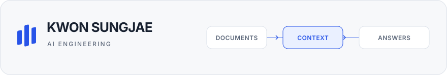

<picture>
  <source media="(prefers-color-scheme: dark)" srcset="assets/profile-header-dark.svg">
  <source media="(prefers-color-scheme: light)" srcset="assets/profile-header-light.svg">
  
</picture>

# 문서의 맥락을, AI의 답변으로.

**권성재 · Python · RAG Systems · AI Backend**

검색과 생성 사이의 연결을 설계합니다. Python으로 문서를 처리하고, 필요한 근거를 찾아 답변으로 연결합니다.

**[포트폴리오 바로가기 ↗](https://pschedule.github.io/)**

[이력서 PDF](https://pschedule.github.io/assets/kwon-sungjae-resume.pdf) &nbsp; · &nbsp; [이메일](mailto:kw8590@naver.com)

한국외국어대학교 컴퓨터공학전공 · 2027년 2월 졸업 예정

## 주요 프로젝트

### 01 · [Multilingual RAG Chatbot](https://pschedule.github.io/projects/multilingual-rag.html)

**3D MUSE 인턴 · 다국어 RAG 구현**  
한국어·영어·일본어·중국어 FAQ의 질문과 답변을 함께 청킹하고, 검색·재정렬·응답 생성 흐름을 구현했습니다.

`Python` `FastAPI` `LangGraph` `Qdrant` `BGE-M3`

**[설계와 구현 →](https://pschedule.github.io/projects/multilingual-rag.html)** &nbsp; · &nbsp; [GitHub 코드 ↗](https://github.com/PSCHEDULE/multilingual-rag-chatbot)

---

### 02 · [Policy Pass](https://pschedule.github.io/projects/policy-pass.html)

**캡스톤 팀 프로젝트 · 백엔드 개발**  
청년정책 질의응답을 위한 FastAPI 백엔드, FAISS 검색 구조와 AWS 배포 환경을 구성했습니다.

`Python` `FastAPI` `FAISS` `AWS` `Docker`

**[설계와 검증 →](https://pschedule.github.io/projects/policy-pass.html)** &nbsp; · &nbsp; [GitHub 코드 ↗](https://github.com/RAG-QnA-Eval-Lab/policy-pass-be)

---

### 03 · [Dot AI](https://pschedule.github.io/projects/dot-ai.html)

**개인 프로젝트 · 문서 기반 Q&A**  
PDF·TXT·Markdown 업로드부터 검색·응답 생성과 출처 표시까지 연결하고, 문서 처리 로직과 Streamlit UI를 분리했습니다.

`Python` `Streamlit` `LangChain` `Chroma`

**[구현 내용 →](https://pschedule.github.io/projects/dot-ai.html)** &nbsp; · &nbsp; [GitHub 코드 ↗](https://github.com/PSCHEDULE/rag-evaluation-pipeline)

---

### 04 · [HUFS Lost & Found](https://pschedule.github.io/projects/hufs-lost-found.html)

**학부 팀 프로젝트 · AI 매칭 담당**  
분실물·습득물 정보의 임베딩 유사도를 활용한 AI 매칭 기능을 개발했습니다.

`OpenAI Embedding` `Pinecone`

**[담당 역할과 구현 →](https://pschedule.github.io/projects/hufs-lost-found.html)**

## 기술과 관심 분야

주로 사용하는 도구: **Python · FastAPI · LangGraph · Qdrant · Docker**

기술 경험 자세히 보기

- **AI·검색:** 임베딩 기반 검색, RAG 시스템 구성, 검색·응답 평가, 딥러닝 응용
- **프레임워크:** FastAPI, LangChain, LangGraph, Streamlit
- **벡터 검색:** Qdrant, Chroma, FAISS, Pinecone
- **개발 도구:** Docker, Git, GitHub

현재의 구현 경험을 바탕으로 **Physics-Informed ML · Neural Operator**, **Surrogate Modeling · Simulation**, **Industrial AI**를 탐구하고 싶습니다.

---

**[프로젝트 전체 살펴보기 →](https://pschedule.github.io/#projects)** &nbsp; · &nbsp; [kw8590@naver.com](mailto:kw8590@naver.com)
